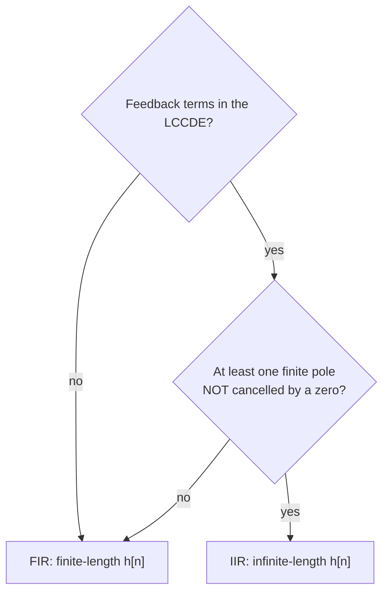

*Lecture 9 · Mon Sep 14, 2026 · notes + slides "Transfer functions and LTI system response: Part 1" · prev: [[2-z-transform/08-inverse-z-transform|Lecture 8]] · next: [[2-z-transform/10-improper-transfer-functions-and-system-algebra|Lecture 10]]*

> [!abstract] In one breath
> - Convolution becomes multiplication: $Y(z) = H(z)X(z)$, with transfer function $H(z) = Y(z)/X(z) = \mathcal{Z}\{h[n]\}$.
> - z-transform an LCCDE: each delay becomes $z^{-k}$, giving $H(z)$ in one line; read it backwards for the LCCDE.
> - Uncancelled finite poles ⇒ IIR; none ⇒ FIR.

## 1. LTI system response with the z-transform

> [!key] Transfer function
> $$
> \begin{aligned}
> Y(z) &= H(z)\,X(z), \qquad \text{ROC at least } R_x \cap R_h, \qquad\qquad \\
> H(z) &= \frac{Y(z)}{X(z)} = \mathcal{Z}\{h[n]\} .
> \end{aligned}
> $$
> Two routes to any output: the convolution sum ([[1-signals-and-systems/04-impulse-response-and-convolution|Lecture 4]]), or multiply in $z$ and invert ([[2-z-transform/08-inverse-z-transform|Lecture 8]]).

"At least": a zero of one factor can cancel a pole of the other and enlarge the ROC of $Y$.

> [!recipe] Output of an LTI system via the z-transform
> 1. $H(z)$ with its ROC (LCCDE + "causal"/"stable"); $X(z)$ with its ROC.
> 2. $Y = HX$; **cancel common factors first**: an input zero can remove a system pole, a system zero an input pole ([[concepts/pole-zero-cancellation|pole-zero cancellation]]).
> 3. ROC of $Y$: at least $R_x \cap R_h$; causal system + right-sided input → outside the largest *remaining* pole.
> 4. [[concepts/partial-fraction-expansion|PFE]] (cover-up $A_k = (1-p_k z^{-1})Y(z)\big|_{z=p_k}$); long-divide first if improper (Lecture 10). Invert term by term.

### 1.1 Transfer functions and LCCDEs

Causal LCCDE, $N$ feedback terms, $M$ input terms:
$$
y[n] + \sum_{k=1}^{N} a_k\, y[n-k] = \sum_{k=0}^{M-1} b_k\, x[n-k].
$$
z-transform both sides (linearity, time shift $x[n-k] \leftrightarrow z^{-k}X(z)$):
$$
\begin{aligned}
Y(z) + \sum_{k=1}^{N} a_k z^{-k}\,Y(z) &= \sum_{k=0}^{M-1} b_k z^{-k}\,X(z)\\
Y(z)\Bigl(1 + \sum_{k=1}^{N} a_k z^{-k}\Bigr) &= X(z)\sum_{k=0}^{M-1} b_k z^{-k} .
\end{aligned}
$$

> [!key] LCCDE ⇄ transfer function
> $$
> \begin{aligned}
> &H(z) = \frac{Y(z)}{X(z)} = \frac{\displaystyle\sum_{k=0}^{M-1} b_k z^{-k}}{\displaystyle 1 + \sum_{k=1}^{N} a_k z^{-k}} \\
> \qquad\Longleftrightarrow\qquad
> &y[n] + \sum_{k=1}^{N} a_k\,y[n-k] = \sum_{k=0}^{M-1} b_k\,x[n-k] .
> \end{aligned}
> $$
> Numerator ↔ input taps, denominator ↔ feedback taps, $z^{-k}$ ↔ delay by $k$.

Uses: impulse response of any LCCDE (compute $H$, invert); response to any input without the convolution sum.

> [!recipe] LCCDE → $H(z)$ → LCCDE
> - **Forward.** All $y$ terms left; $y[n-k] \to z^{-k}Y(z)$, $x[n-k] \to z^{-k}X(z)$; $H = Y/X$. Factor (zeros, poles); ROC from the words: **causal → outside the largest pole**, stable → ring containing $|z| = 1$ ([[2-z-transform/11-bibo-stability-and-causality|Lecture 11]]).
> - **Backward.** Multiply out the denominator, cross-multiply $Y(z)\cdot\text{den} = X(z)\cdot\text{num}$, read $z^{-k}$ as delay by $k$.

> [!trap] Signs and ROC
> - [[1-signals-and-systems/05-difference-equations-and-block-diagrams|Lecture 5]] writes $y[n] = \sum_{i=1}^{K} b_i\, y[n-i] + \sum_{j=0}^{M-1} c_j\, x[n-j]$: feedback on the **right**, $b_i$ = feedback.
> - Lecture 9: $a_k = -b_k^{(\text{L5})}$ and $b_k^{(\text{L9})} = c_k^{(\text{L5})}$.
> - $y[n] = \tfrac12 y[n-1] + \tfrac{3}{16}y[n-2] + \dots$ has denominator $1 - \tfrac12 z^{-1} - \tfrac{3}{16}z^{-2}$; $1 + \dots$ puts every pole in the wrong place.
> - The LCCDE alone does not fix the ROC: $y[n] - \tfrac12 y[n-1] = x[n]$ fits $(\tfrac12)^n u[n]$ and $-(\tfrac12)^n u[-n-1]$. "Causal", "stable" or "initially at rest" picks it.

> [!question] Exercise 1 (notes) — impulse response of the causal $y[n] = \tfrac12 y[n-1] + x[n]$
> Slides Exercise 1: the same with $\tfrac13$.

> [!success]- Answer
> $Y(z)\bigl(1 - \tfrac12 z^{-1}\bigr) = X(z)$, so $H(z) = \dfrac{1}{1-\frac12 z^{-1}}$, $|z| > \tfrac12$ (causal), and $h[n] = (\tfrac12)^n u[n]$ by inspection (Lecture 5's answer). Slides: $h[n] = (\tfrac13)^n u[n]$.

> [!question] Slides, Exercises 2 and 3 — impulse responses of causal LCCDEs
> (2) $y[n] = \tfrac13 y[n-1] + x[n] - 3x[n-1] + x[n-2]$  (3) $y[n] = \tfrac12 y[n-1] + \tfrac{3}{16} y[n-2] + x[n] - 3x[n-1]$

> [!success]- Answers
> **(2)** $H(z) = \dfrac{1-3z^{-1}+z^{-2}}{1-\frac13 z^{-1}} = \dfrac{1}{1-\frac13 z^{-1}} - \dfrac{3z^{-1}}{1-\frac13 z^{-1}} + \dfrac{z^{-2}}{1-\frac13 z^{-1}}$, $|z| > \tfrac13$:
> $$
> \begin{aligned}
> h[n] &= \left(\tfrac13\right)^n u[n] - 3\left(\tfrac13\right)^{n-1} u[n-1] + \left(\tfrac13\right)^{n-2} u[n-2] \\
> &= \left(\tfrac13\right)^n u[n] - 3\,\delta[n-1],
> \end{aligned}
> $$
> ($h = \{\underset{\uparrow}{1}, -\tfrac83, \tfrac19, \tfrac1{27}, \dots\}$). Long division gives the short form directly: $H = -3z^{-1} + \dfrac{1}{1-\frac13 z^{-1}}$; this $H$ is *improper* ([[2-z-transform/10-improper-transfer-functions-and-system-algebra|Lecture 10]]).
> **(3)** $H(z) = \dfrac{1-3z^{-1}}{1-\frac12 z^{-1}-\frac{3}{16}z^{-2}} = \dfrac{1-3z^{-1}}{(1+\frac14 z^{-1})(1-\frac34 z^{-1})} = \dfrac{A_1}{1+\frac14 z^{-1}} + \dfrac{A_2}{1-\frac34 z^{-1}}$. Cover-up: $A_1 = \dfrac{1-3z^{-1}}{1-\frac34 z^{-1}}\Big|_{z=-1/4} = \dfrac{1+12}{1+3} = \dfrac{13}{4}$, $A_2 = \dfrac{1-3z^{-1}}{1+\frac14 z^{-1}}\Big|_{z=3/4} = \dfrac{1-4}{1+\frac13} = -\dfrac94$. Causal:
> $$
> h[n] = \tfrac{13}{4}\left(-\tfrac14\right)^n u[n] - \tfrac94\left(\tfrac34\right)^n u[n] .
> $$

### 1.2 Characterizing transfer functions

- Multiply by a power of $z$ to get polynomials in $z$. **Zeros**: numerator roots; **poles**: denominator roots ([[concepts/poles-and-zeros|poles and zeros]]).
- $N$ feedback terms → $N$ poles, the roots of $z^N + a_1 z^{N-1} + \dots + a_N$. $N$ is the **order**.
- Numerator: degree $M-1$ in $z^{-1}$, so $M-1$ zeros (the notes say "$M$"); extra poles or zeros at $z = 0$ balance the totals.
- Pole and zero at the same place **cancel**: $H$ neither blows up nor vanishes there; the pole is gone for ROC, stability and FIR/IIR.

> [!key] FIR vs IIR
> - Any **finite** pole (not at $z = 0$ or $\infty$) not cancelled by a zero ⇒ **IIR**.
> - No finite poles (denominator a monomial, e.g. $N = 0$) ⇒ **FIR**.
> - Causal FIR: poles only at $z = 0$ (non-causal: also $z = \infty$). Hence FIR is always stable (Lecture 11).

Notes Fig. 1:

Feedback yet FIR: $y[n] = y[n-1] + x[n] - x[n-2]$ gives $H = \dfrac{(1-z^{-1})(1+z^{-1})}{1-z^{-1}} = 1 + z^{-1}$, so $h[n] = \delta[n] + \delta[n-1]$.

> [!exam] LCCDE ↔ $H(z)$ ↔ response — every past exam, 15–20 points
> LCCDE → $H$, poles, zeros, ROC → output for a short input whose zero often cancels a pole. Recipe: [[problems/lccde-to-transfer-function-and-response|LCCDE → transfer function → response]].
> [[exams/midterm-1/past-exams/fall-2025|FA2025 #6]] · [[exams/midterm-1/past-exams/spring-2025|SP2025 #8]] · [[exams/midterm-1/past-exams/fall-2024|FA2024 #1(d)–(e), #6]] · [[exams/midterm-1/past-exams/fall-2023|FA2023 #6(b), #7]] · [[exams/midterm-1/past-exams/spring-2023|SP2023 #5, #6]] · [[exams/midterm-1/past-exams/spring-2021|SP2021 #6, #7]] · [[exams/midterm-1/past-exams/fall-2019|FA2019 #1(a), #10]]

## Related

[[concepts/transfer-function|transfer function]] · [[concepts/lccde|LCCDE]] · [[concepts/poles-and-zeros|poles and zeros]] · [[concepts/pole-zero-cancellation|pole-zero cancellation]] · [[concepts/fir-and-iir|FIR and IIR]] · [[concepts/partial-fraction-expansion|partial-fraction expansion]] · [[concepts/inverse-z-transform|inverse z-transform]] · [[concepts/z-transform-properties|z-transform properties]] · [[demos/difference-equation-simulator|difference-equation simulator]] · [[homework/hw4|HW4]] · unit: [[2-z-transform/index|Unit 2]]

### Sources for this page

Snyder, Lecture 9 notes (§1, §1.1 with Exercise 1, §1.2, Fig. 1); slides 1–8 (Exercises 1–3); Lecture 5 notes eq. (1); past exams above.
