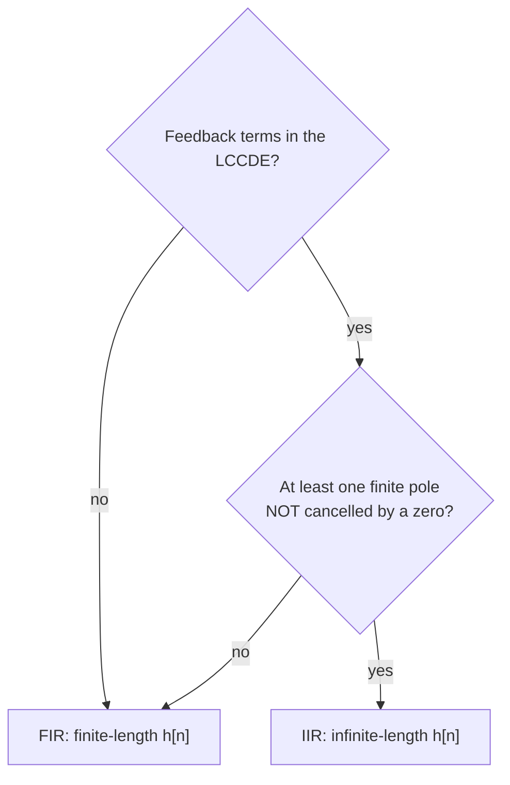

*Lectures 6 (Fri Sep 4) §2 and 9 (Mon Sep 14) §1.2 · [[homework/hw3|HW3]] #4 · families: [[problems/all-possible-rocs|all possible ROCs]], [[problems/lccde-to-transfer-function-and-response|LCCDE → H(z) → response]]*

> [!abstract] In one breath
> - Zeros: $X(z)=0$; poles: $X(z)\to\infty$; multiply by a power of $z$ to see the ones hiding at $z=0$.
> - $N$ feedback terms → $N$ poles (the order); a pole and zero at the same place cancel and the pole is gone for ROC, stability and FIR/IIR.
> - Each uncancelled finite pole is a mode $p^n$: decays inside the unit circle, grows outside, never dies on it.

## 1. Definition and the pole-zero plot

> [!key] Definition (Lecture 6 §2)
> **Zeros:** $X(z)=0$. **Poles:** $X(z)\to\infty$.
> $$
> X(z) = b_0\,\frac{\prod_{k}\left(1-q_k z^{-1}\right)}{\prod_{k}\left(1-p_k z^{-1}\right)}
> \qquad\Longrightarrow\qquad \text{zeros at } q_k,\ \ \text{poles at } p_k .
> $$
> Plot: poles ×, zeros ○, ROC shaded, unit circle dashed. Multiply by the highest power of $z$ to see poles or zeros at $z=0$.

> [!example] HW3 #4: $H(z) = \dfrac{1-3z^{-1}}{1+\frac16 z^{-1}-\frac13 z^{-2}}=\dfrac{z(z-3)}{(z-\frac12)(z+\frac23)}$, right-sided
> Zeros $3$, $0$; poles $\frac12$, $-\frac23$; ROC $|z|>\frac23$, stable. $h[n] = \frac{22}{7}\left(-\frac23\right)^n u[n] - \frac{15}{7}\left(\frac12\right)^n u[n]$.

<figure class="ece-fig"><svg xmlns="http://www.w3.org/2000/svg" viewBox="0 0 420 330" width="420" height="330" role="img" style="font-family:'Source Sans 3','Source Sans Pro',system-ui,sans-serif;font-size:14px"><defs><marker id="ahpz" viewBox="0 0 10 10" refX="9" refY="5" markerWidth="7" markerHeight="7" orient="auto-start-reverse"><path d="M0,0 L10,5 L0,10 z" fill="context-stroke"/></marker></defs><clipPath id="pzclip"><rect x="15.0" y="10.0" width="400.0" height="300.0"/></clipPath><path d="M15.0,10.0 h400.0 v300.0 h-400.0 Z M228.67,160.00 A38.67,38.67 0 1,0 151.33,160.00 A38.67,38.67 0 1,0 228.67,160.00 Z" fill="var(--accent)" fill-opacity="0.16" fill-rule="evenodd" stroke="none" clip-path="url(#pzclip)"/><circle cx="190.0" cy="160.0" r="38.7" fill="none" stroke="var(--accent)" stroke-width="1.4"/><line x1="15.0" y1="160.0" x2="412.0" y2="160.0" stroke="currentColor" stroke-width="1.1" opacity="0.8" stroke-linecap="round"/><line x1="190.0" y1="10.0" x2="190.0" y2="310.0" stroke="currentColor" stroke-width="1.1" opacity="0.8" stroke-linecap="round"/><circle cx="190.0" cy="160.0" r="58.0" fill="none" stroke="currentColor" stroke-width="1.3" stroke-dasharray="5 4"/><circle cx="190.0" cy="160.0" r="6.5" fill="none" stroke="var(--accent2)" stroke-width="2.2"/><circle cx="364.0" cy="160.0" r="6.5" fill="none" stroke="var(--accent2)" stroke-width="2.2"/><line x1="213.0" y1="154.0" x2="225.0" y2="166.0" stroke="var(--hi)" stroke-width="2.4" stroke-linecap="round"/><line x1="213.0" y1="166.0" x2="225.0" y2="154.0" stroke="var(--hi)" stroke-width="2.4" stroke-linecap="round"/><line x1="145.3" y1="154.0" x2="157.3" y2="166.0" stroke="var(--hi)" stroke-width="2.4" stroke-linecap="round"/><line x1="145.3" y1="166.0" x2="157.3" y2="154.0" stroke="var(--hi)" stroke-width="2.4" stroke-linecap="round"/><text x="364.0" y="184.0" text-anchor="middle" fill="var(--accent2)" style="font-size:14px;font-weight:600;">3</text><text x="199.0" y="182.0" text-anchor="start" fill="var(--accent2)" style="font-size:13px;">0</text><text x="221.0" y="148.0" text-anchor="middle" fill="var(--hi)" style="font-size:14px;font-weight:600;">½</text><text x="147.3" y="148.0" text-anchor="end" fill="var(--hi)" style="font-size:14px;font-weight:600;">−⅔</text><text x="192.0" y="94.0" text-anchor="start" fill="var(--muted)" style="font-size:12px;">|z| = 1</text><text x="412.0" y="154.0" text-anchor="end" fill="var(--muted)" style="font-size:12px;">Re</text><text x="196.0" y="23.0" text-anchor="start" fill="var(--muted)" style="font-size:12px;">Im</text><text x="25.0" y="26.0" text-anchor="start" fill="var(--accent)" style="font-size:13px;">ROC: |z| &gt; ⅔ (shaded)</text></svg><figcaption><strong>Pole-zero plot of HW3 #4.</strong> Poles × at ½ and −⅔, zeros ○ at 3 and 0; ROC |z| &gt; ⅔ contains the unit circle, so the system is stable.</figcaption></figure>

## 2. Characterizing transfer functions (Lecture 9 §1.2)

- Multiply by a power of $z$ to get polynomials in $z$. **Zeros**: numerator roots; **poles**: denominator roots.
- $N$ feedback terms → $N$ poles, the roots of $z^N + a_1 z^{N-1} + \dots + a_N$. $N$ is the **order**.
- Numerator: degree $M-1$ in $z^{-1}$, so $M-1$ zeros (the notes say "$M$"); extra poles or zeros at $z = 0$ balance the totals.
- Pole and zero at the same place **cancel**: $H$ neither blows up nor vanishes there; the pole is gone for ROC, stability and FIR/IIR ([[concepts/pole-zero-cancellation|pole-zero cancellation]]).

> [!key] FIR vs IIR (Lecture 9, Fig. 1; full page: [[concepts/fir-and-iir|FIR and IIR]])
> - Any **finite** pole (not at $z = 0$ or $\infty$) not cancelled by a zero ⇒ **IIR**.
> - No finite poles (denominator a monomial, e.g. $N = 0$) ⇒ **FIR**.
> - Causal FIR: poles only at $z = 0$ (non-causal: also $z = \infty$). Hence FIR is always stable ([[concepts/bibo-stability|BIBO stability]]).

Feedback yet FIR: $y[n] = y[n-1] + x[n] - x[n-2]$ gives $H = \dfrac{(1-z^{-1})(1+z^{-1})}{1-z^{-1}} = 1 + z^{-1}$, so $h[n] = \delta[n] + \delta[n-1]$.

## 3. What a pole means in time

| pole | right-sided mode $p^n u[n]$ |
|---|---|
| $0<p<1$ | decays |
| $-1<p<0$ | decays, alternating |
| $\lvert p\rvert = 1$ | never decays ([[concepts/marginal-stability\|marginal]]) |
| $\lvert p\rvert > 1$ | grows |
| $re^{\pm j\omega_0}$ | $r^n\cos(\omega_0 n+\theta)$ |

- **Zeros block:** $H(z_0)=0$ ⇒ input $z_0^n$ gives zero output ($1-z^{-1}$ kills constants).
- **Causal stable ⇔ every pole inside $|z|=1$.** FIR: poles only at $0$ or $\infty$.
- **On the unit circle:** $\lvert H_d(\omega)\rvert=\lvert G\rvert\,\frac{\prod_k\lvert e^{j\omega}-z_k\rvert}{\prod_k\lvert e^{j\omega}-p_k\rvert}$; poles near the circle peak, zeros on it null.

> [!trap]
> - Poles are values of $z$: $(1-2z^{-1})$ is a pole at $z=2$. Zeros at $z=0$ hide in the $z^{-1}$ form: rewrite in positive powers before listing.
> - Zeros may lie in the ROC; poles may not ([[exams/midterm-1/past-exams/fall-2023|FA2023]] T/F (b)).
> - $\frac{1}{1-z^{-3}}$ has three distinct poles, the cube roots of unity ([[exams/midterm-1/past-exams/fall-2024|FA2024]] T/F (e)).
> - $e^{j2/3}$ sits at $\frac23$ rad, not $120^\circ$ ([[exams/midterm-1/past-exams/fall-2025|FA2025]] #8b).

> [!exam] On the exams
> Poles, zeros and order of every $H(z)$ in the LCCDE problems; pole-zero plots to read off stability and causality; T/F on where poles may sit.
> [[exams/midterm-1/past-exams/fall-2025|FA2025 #6, #8b]] · [[exams/midterm-1/past-exams/fall-2024|FA2024 #1(d)–(e), T/F (e)]] · [[exams/midterm-1/past-exams/fall-2023|FA2023 #7, T/F (b)]] · [[exams/midterm-1/past-exams/spring-2021|SP2021 #6]] · families: [[problems/all-possible-rocs|all possible ROCs]], [[problems/lccde-to-transfer-function-and-response|LCCDE → H(z) → response]]

**Where it appears:** [[2-z-transform/06-the-z-transform|L6]] §2 (Fig. 1), [[2-z-transform/08-inverse-z-transform|L8]], [[2-z-transform/09-transfer-functions|L9]] §1.2 (Fig. 1), [[2-z-transform/11-bibo-stability-and-causality|L11]], [[3-fourier-analysis/16-magnitude-and-phase-response|L16]]; [[problems/all-possible-rocs|All possible ROCs (inverse z by partial fractions)]], [[problems/unbounded-outputs-and-pole-matching|Unbounded outputs and pole matching]]; [[homework/hw3|HW3]] #4; [[demos/pole-zero-and-roc-explorer|pole-zero and ROC explorer]].

## Related
[[concepts/region-of-convergence]] · [[concepts/transfer-function]] · [[concepts/pole-zero-cancellation]] · [[concepts/marginal-stability]] · [[concepts/bibo-stability]] · [[concepts/fir-and-iir]] · [[concepts/lccde]]

### Sources for this page
Lecture 6 §2 (Fig. 1); Lecture 8 §1.2; Lecture 9 §1.2 (Fig. 1); Lecture 11 §1.1; Lecture 16 Exercise 1; HW3 #4 solution; Midterm 1 keys cited.
