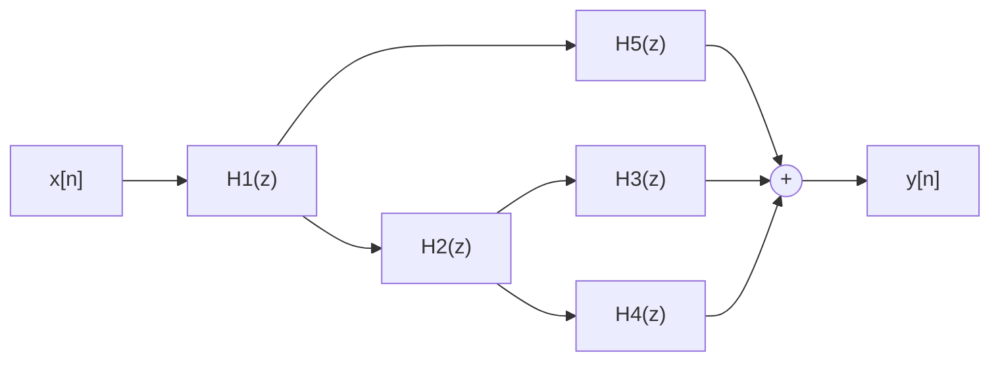

> [!key] Series and parallel (Lecture 10, Table 1)
> | connection | $h[n]$ | $H(z)$ |
> |---|---|---|
> | parallel | $h_1[n] + h_2[n]$ | $H_1(z) + H_2(z)$ |
> | series | $h_1[n] * h_2[n]$ | $H_1(z)\,H_2(z)$ |
>
> ROC at least $R_1\cap R_2$. Cascade order does not matter.

> [!recipe] Collapsing a block diagram
> 1. Name every block and adder output. 2. One z-domain equation per block and adder.
> 3. Eliminate internal signals; $H=Y/X$. 4. Attach ROC; cancel before judging stability.

> [!example] Lecture 10 slides: the five-block system above
> $$
> H(z) = H_1(z)\Big(H_5(z) + H_2(z)\big(H_3(z)+H_4(z)\big)\Big).
> $$

> [!example] SP2025 #3: missing parallel branch
> $h_1[n] = \delta[n-1]$ in parallel with $h_2$; $x = \{\underset{\uparrow}{1}, 2, 1\}$ gives $y = \{1, \underset{\uparrow}{2}, 2, 2, 1\}$. Find $h_2$.

> [!success]- Answer
> $Y - z^{-1}X = zX$, so $h_2[n] = \delta[n+1]$, $h[n] = \{1, \underset{\uparrow}{0}, 1\}$: not causal.

- Stable + stable and stable × stable are stable.
- Unstable parts can combine into a stable whole by [[concepts/pole-zero-cancellation|cancellation]] ([[homework/hw4|HW4]] #5; $u[n] + (\delta[n]-u[n]) = \delta[n]$).

> [!trap]
> - Series means **convolve** in time, not multiply $h_1[n]h_2[n]$.
> - Recompute the ROC from surviving poles.
> - "Two unstable systems never combine into a stable one" is False ([[exams/midterm-1/past-exams/fall-2025|FA2025]] T/F (f), [[exams/midterm-1/past-exams/spring-2021|SP2021]] (c)).

**Where it appears:** [[2-z-transform/10-improper-transfer-functions-and-system-algebra|L10]], [[1-signals-and-systems/04-impulse-response-and-convolution|L4]]; [[problems/finding-h-from-input-output-pairs]] (SP2025 #3, FA2024 #3); [[exams/midterm-1/true-false-bank|T/F bank]].

## Related
[[concepts/transfer-function]] · [[concepts/convolution]] · [[concepts/pole-zero-cancellation]] · [[concepts/block-diagram]] · [[concepts/lti-system]]

### Sources for this page
Lecture 10 notes §2 (Eqs. 15–20, Table 1), slides 10–11; HW4 #5; SP2025 #3, FA2024 #3 keys and T/F items cited.
